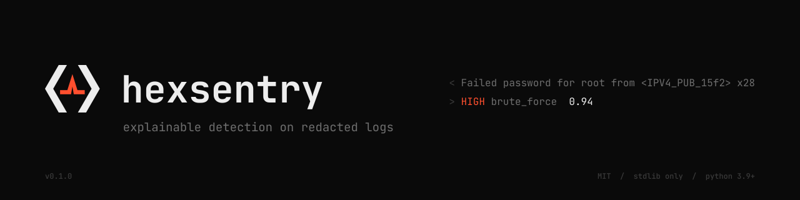

<p align="center">
  <picture>
    <source media="(prefers-color-scheme: dark)" srcset="assets/banner-dark.svg">
    <source media="(prefers-color-scheme: light)" srcset="assets/banner-light.svg">
    
  </picture>
</p>

# hexsentry

**Explainable SSH login anomaly detection that runs on redacted logs.**

hexsentry reads OpenSSH authentication logs and flags brute force, password spraying, distributed attacks, logins that follow a burst of failures, impossible travel and unusual login times. Every alert says, in plain English, what was seen, which limit it crossed, and how confident the detector is.

It is built to sit after [hexredact](https://github.com/happygream/hexredact): redact first, then detect. The analysis side can work entirely on tokens like `<USER_a02430c6c2>` and `<IPV4_PUB_8c8e81c45d>`, and never handle a real username or address.

Zero dependencies. Python 3.9+ standard library only. Linux, macOS and Windows.

```
 CRITICAL  Impossible travel  impossible_travel  id dcbe17436024
           user <USER_a02430c6c2>   src <IPV4_RSVD_8c8e81c45d>   prev_src <IPV4_RSVD_0a7fb130d3>
           when 2026-10-27T09:02:00Z → 2026-10-27T09:31:00Z   confidence ██████████ 0.99
           <USER_a02430c6c2> logged in from London, GB (<IPV4_RSVD_0a7fb130d3>) and then
           from Sydney, AU (<IPV4_RSVD_8c8e81c45d>) 29m 00s later. The places are 16,995 km
           apart, which needs 35,162 km/h; the limit is 900 km/h (airliner speed). Either
           the account is shared, a VPN changed exit point, or someone else has the
           credentials.
           evidence demo_auth_redacted.log lines 694, 696
```

## Why

Security logs are full of personal data, so the people best placed to analyse them often aren't allowed to see them. Pseudonymising first and detecting second solves that: tokens are consistent, so `<USER_a02430c6c2>` is the same person on every line and the statistics still work. When an alert matters, the data owner resolves the tokens with `hexredact lookup`.

Detection is deliberately transparent. Each rule is a small statistical check with a named threshold, not a model, so an analyst (or an auditor) can see exactly why something fired and argue with it.

## Quick start

```bash
pip install .                 # or: python -m hexsentry (from src/), or hexsentry.bat on Windows
hexsentry demo                # synthetic log with six planted incidents, scanned with GeoIP
hexsentry                     # interactive menu
```

The demo writes `hexsentry-demo/` with the log, a GeoIP CSV, and JSON and CSV reports. All addresses are RFC 5737 documentation ranges and all names are invented.

## The redact-then-detect pipeline

```bash
# Data owner, once: redact, then turn the reverse map into coarse token locations
hexredact redact auth.log                     # -> auth_redacted.log + auth_redaction_map.json
hexsentry geomap auth_redaction_map.json --geoip dbip-city-lite.csv -o token_geo.csv

# Analyst: only ever sees the redacted log and token_geo.csv
hexsentry scan auth_redacted.log --token-geo token_geo.csv --json report.json

# Data owner, for an alert worth chasing
hexredact lookup auth_redaction_map.json '<USER_a02430c6c2>'
```

`token_geo.csv` holds `token,country,city,lat,lon` with coordinates rounded to one decimal place (about 11 km) and no IP addresses, so impossible travel works on redacted data without the addresses leaving the data owner. Streaming works too:

```bash
hexredact redact - --map map.json < /var/log/auth.log | hexsentry scan --token-geo token_geo.csv
```

hexsentry also runs on raw logs: `hexsentry scan /var/log/auth.log --geoip dbip-city-lite.csv`.

## Rules

| Rule | Fires when | Default limit |
|---|---|---|
| `brute_force` | one source fails many times on one account | 10 failures in 10 min |
| `password_spray` | one source tries many usernames, few attempts each | 5 usernames in 30 min, ≤3 tries each |
| `distributed_attack` | one account fails from many sources | 5 sources in 60 min |
| `success_after_failures` | a login succeeds right after a burst of failures from that source or on that account | 5 failures in the previous 30 min |
| `impossible_travel` | two logins for one user are too far apart for the time between them | 900 km/h and at least 500 km |
| `odd_hours` | a login at an hour the user almost never uses | ≤3% of their logins within an hour of it, given 10+ logins of history |

Severity reflects what the activity means (a guessed password on the same account and source is critical; a key-based login from a noisy address is downgraded and says why). Confidence starts at a per-rule base at exactly the threshold and rises towards 0.99 the further the activity goes past it.

`hexsentry rules` lists them with the thresholds currently in force. Override any of them with `--config`:

```json
{ "brute_force": { "failures": 20, "window_min": 5 }, "odd_hours": { "quiet_start": 23, "quiet_end": 6 } }
```

## Feedback tuning

```bash
hexsentry feedback cd3a9c benign --note "bob was on call"
hexsentry feedback 8595dc malicious
```

- **Benign** suppresses future alerts with the same fingerprint: the same rule about the same entities. That is the user and source for most rules, the source alone for `password_spray`, and the user alone for `distributed_attack`, so a benign mark there covers that account from any sources. Suppressed alerts stay in the JSON with `"suppressed": true` and show with `--show-suppressed`.
- Each rule's main threshold is scaled by `0.5 / p`, where `p = (malicious + 2) / (malicious + benign + 4)` is a smoothed precision estimate. No feedback means ×1.0; mostly-benign marks raise the bar and mostly-malicious marks lower it, clamped to ×0.75–×3.0.
- The report footer and `hexsentry rules` show every tuned threshold, the multiplier and the marks behind it.

`--no-feedback` gives the untuned rule output. `feedback <id> --undo` removes a mark.

## Audit trail

Every scan and every feedback mark is appended to `~/.hexsentry/audit.jsonl`: inputs (with SHA-256), thresholds and multipliers in force, each alert with its reason and evidence lines, and each verdict with the threshold change it caused. Records are hash-chained, so editing, deleting or reordering any line is detected. `audit.head` holds the latest sequence number and hash, so cutting records off the end is caught too:

```bash
hexsentry audit verify      # ok   26 records, chain intact
hexsentry audit show -n 10
```

Set `HEXSENTRY_AUDIT_KEY` to chain with HMAC-SHA256 instead of plain SHA-256, so someone without the key can't rebuild the chain; with the key set, `verify` also rejects any record that isn't keyed. Use the key from the first record onwards. Someone who can rewrite both files without the key set can still forge an unkeyed log, so it is tamper-evident, not tamper-proof: ship it to append-only storage if that matters.

## Output

| | |
|---|---|
| terminal | colour report, `NO_COLOR` honoured; `--min-severity`, `--limit`, `-q` |
| `--json PATH` | full report: inputs and hashes, stats, thresholds, tuning, every alert with evidence |
| `--csv PATH` | one flat row per alert, for SAS Viya, Excel or pandas |

Use `-` as the path to write to stdout; everything human-readable then goes to stderr, so stdout is pure JSON or CSV. `--fail-on high` exits `3` when anything at or above that severity is found, for cron or CI.

`sas/load_alerts.sas` reads the CSV into SAS and charts alerts by rule, severity and time.

## GeoIP data

Any of these works with `--geoip` (repeatable):

- [DB-IP IP to City Lite](https://db-ip.com/db/download/ip-to-city-lite) CSV, used as downloaded (CC BY 4.0; attribution required if you redistribute it)
- MaxMind GeoLite2-style CSV with `network`, `latitude`, `longitude` columns (free account and licence)
- your own CSV with `network` or `start`/`end` columns plus `country`, `city`, `latitude`, `longitude`

Lookups are offline. Internal sources (RFC 1918, CGNAT, loopback, link-local, ULA, and hexredact `_PRIV` / `_LOOP` tokens) are never located.

## Input

- `/var/log/auth.log`, `/var/log/secure`, rotated `.1` and `.gz` files, a directory of them (read oldest first), or a wildcard like `auth.log*` (expanded by hexsentry, so it works in Windows cmd too)
- classic syslog timestamps (`Oct 28 03:14:07`) and ISO 8601 (`2026-10-28T03:14:07.123456+00:00`)
- `sshd` and `sshd-session` (OpenSSH 9.8+), and IPv4-mapped IPv6 sources (`::ffff:203.0.113.5`), `message repeated N times`, and "Invalid user" lines on key-only servers
- `journalctl -u ssh -o short-iso` exports

Classic syslog has no year; it is inferred (and rolls over at New Year), or set it with `--year`. `--tz +01:00` sets the offset for timestamps without one and for odd-hours checks.

## Exit codes

| Code | Meaning |
|---|---|
| `0` | success |
| `1` | error |
| `2` | usage error |
| `3` | alerts at or above `--fail-on` |
| `130` | interrupted |

## Limits

- Baselines are learned from the data in the scan, not stored between runs, so odd-hours needs enough history in one scan (it falls back to fixed quiet hours, at low confidence, when there isn't).
- Impossible travel trusts GeoIP, which is coarse and wrong for many VPN and mobile addresses. The alert's reason text names that as a possible cause.
- Usernames in sshd logs are attacker-controlled. The parser always takes the source from the last `from <addr> port N` sshd wrote, so a username like `x from 8.8.8.8 port 1` can't frame another address.
- One log format for now. Windows logon events and web login endpoints are on the roadmap.

## Development

```bash
python -m unittest discover -s tests      # 66 tests, stdlib only
ruff check .
```

## License

MIT
